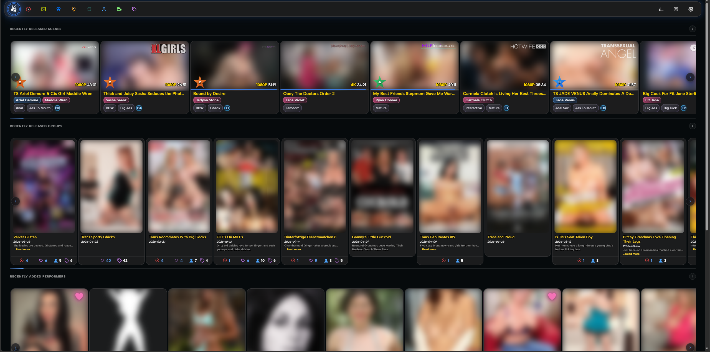
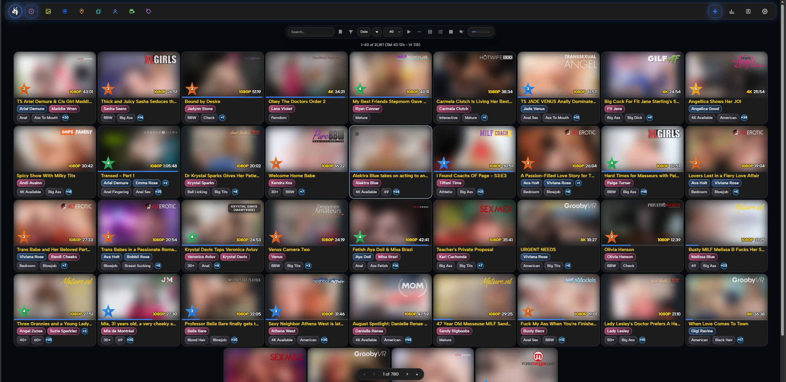
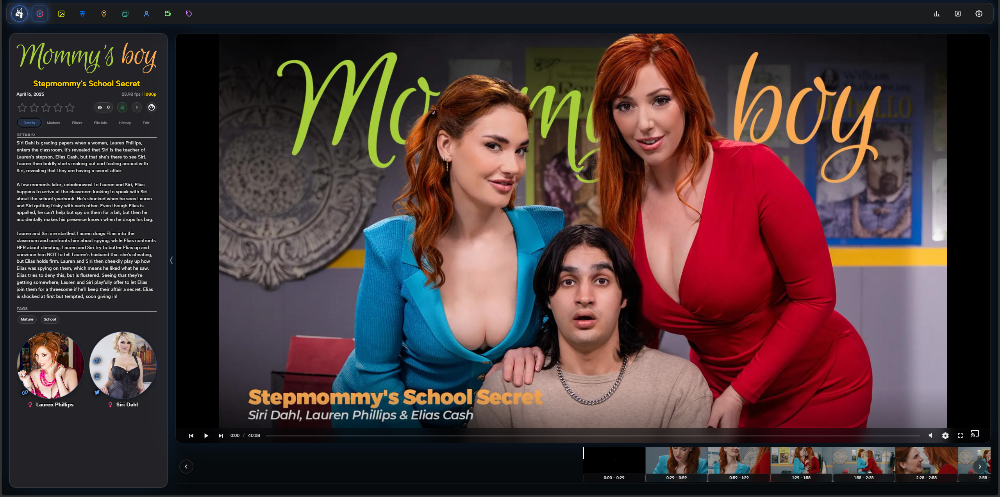
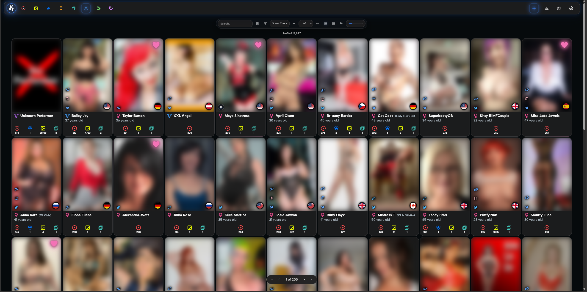
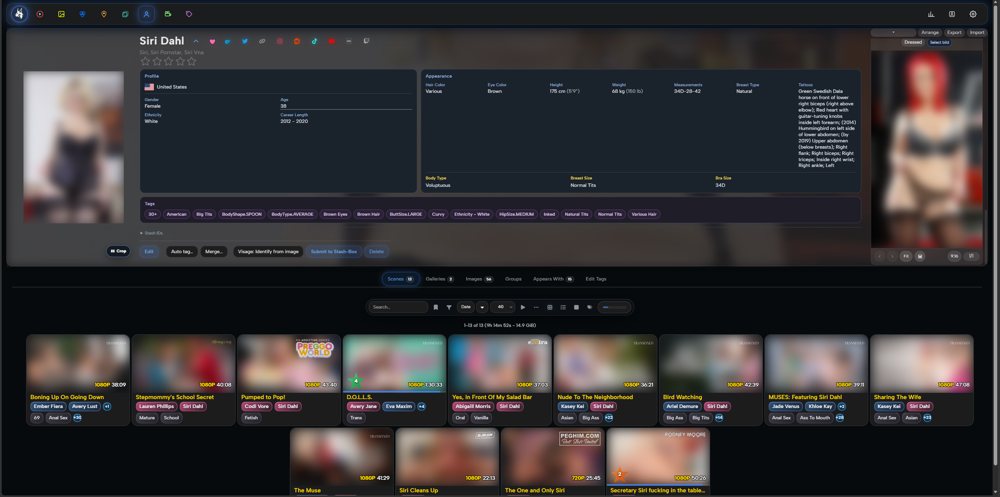
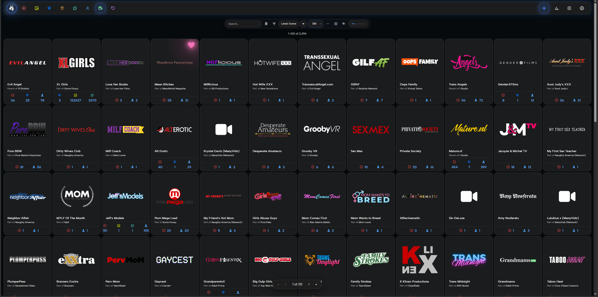
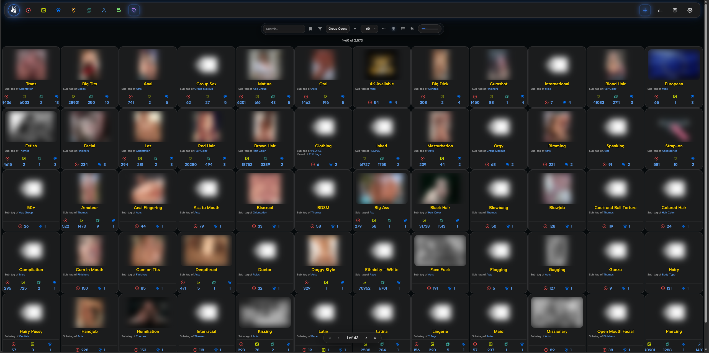
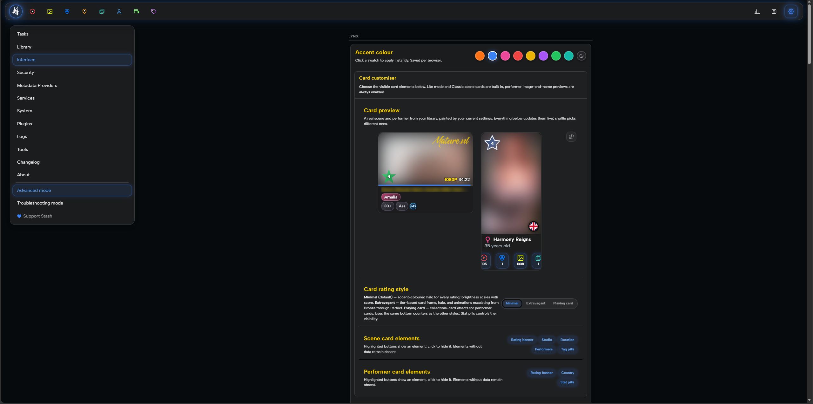
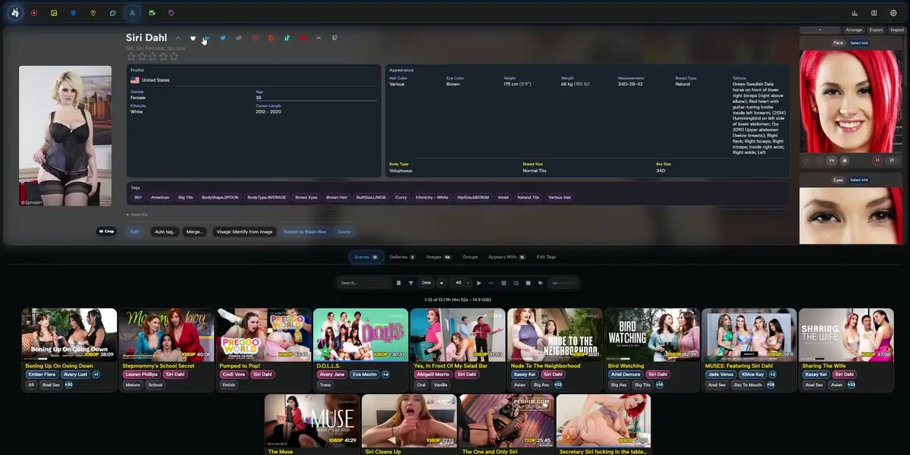
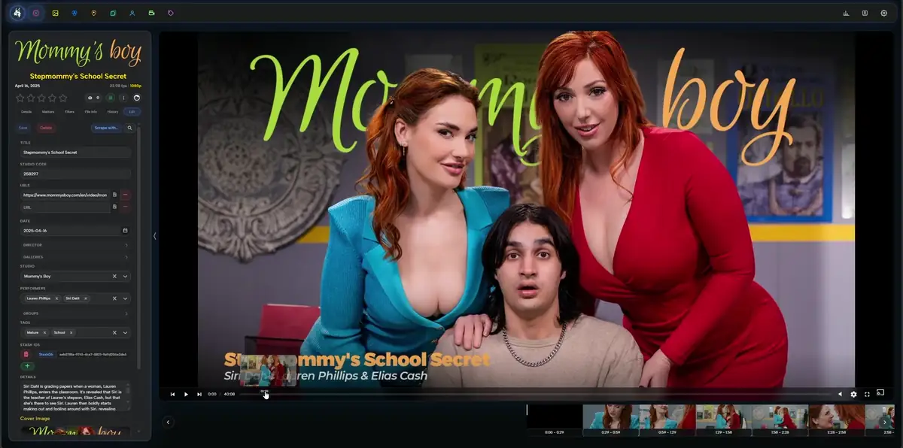

# Lynx Stash Suite

**A darker look. A clearer workflow. Your Stash, your way.**

A glass-inspired theme and a collection of practical tools for [Stash](https://github.com/stashapp/stash).

[Install directly in Stash](#install-directly-in-stash) · [Browse the plugins](#explore-the-suite) · [Download releases](https://github.com/DirtySolutionsLab/Lynx-Stash-Suite/releases) · [Installation guide](INSTALLATION.md) · [Credits](CREDITS.md) · [Report an issue](https://github.com/DirtySolutionsLab/Lynx-Stash-Suite/issues)

> [!WARNING]
> **NSFW content advisory.** Screenshots, videos, example metadata and linked previews may contain adult-oriented imagery, explicit titles or sexual terminology. Open previews only if you are comfortable viewing this material. Visual masking is not guaranteed to hide every detail.

> [!WARNING]
> **Pre-release software — use at your own risk.** Lynx themes, plugins and scrapers are experimental and provided **AS IS**, without warranties or guarantees. Back up your Stash configuration, database and affected files; test in a separate instance before enabling automatic or bulk operations. To the extent permitted by applicable law and the component licenses, the maintainer accepts no liability for loss or damage arising from their use. Read the [full disclaimer](DISCLAIMER.md).

---

## Welcome to Lynx

Lynx brings together a dark interface, configurable cards, performer tools, metadata scraping and everyday library utilities. Install the parts you want — you do not need the entire suite.

This is my first GitHub project. I am new to publishing code, but I have been an active Stash user for a long time. These tools grew out of changes I wanted in my own library, developed with AI assistance and, where documented, building on community projects.

Feedback, reproducible bug reports and suggestions are welcome.

Read each component's release notes and installation guide before use. See the [pre-release disclaimer and content advisory](DISCLAIMER.md).

## Quick navigation

- [Explore the suite](#explore-the-suite)
- [Lynx Theme](#lynx-theme)
- [Lynx Performer Suite](#lynx-performer-suite)
- [Lynx Scene Card](#lynx-scene-card)
- [Lynx Tools](#lynx-tools)
- [Lynx Scraping Suite](#lynx-scraping-suite)
- [Lynx Renamer](#lynx-renamer)
- [Lynx Missing Performer Images](#lynx-missing-performer-images)
- [Lynx Default Tabs](#lynx-default-tabs)
- [Installation](#installation)
- [Support and feedback](#support-and-feedback)
- [Credits and licenses](#credits-and-licenses)

## Explore the suite

| Component | What it adds | Documentation |
| --- | --- | --- |
| **Lynx Theme** | Dark glass styling for navigation, cards, filters, detail pages and the player. | [Read more](themes/LynxTheme/README.md) |
| **Lynx Performer Suite** | Attribute tags, tag transfer, performer matching, performer links and supporting images. | [Read more](plugins/LynxPerformerSuite/README.md) |
| **Lynx Scene Card** | Custom titles, performer and tag chips, overflow lists and hover previews. | [Read more](plugins/LynxSceneCard/README.md) |
| **Lynx Tools** | Context menus, image cropping and single-eye VR viewing modes. | [Read more](plugins/LynxTools/README.md) |
| **Lynx Scraping Suite** | Performer scraping and reviewed batch imports from XL Girls and Mature.nl. | [Read more](plugins/LynxScrapingSuite/README.md) |
| **Lynx Renamer** | Guided filename and destination rules, previews and optional automation. | [Read more](plugins/LynxRenamer/README.md) |
| **Lynx Missing Performer Images** | Find, review and approve portraits for performers without an image. | [Read more](plugins/LynxMissingPerformerImages/README.md) |
| **Lynx Default Tabs** | Open scenes, images and galleries on your preferred tab. | [Read more](plugins/LynxDefaultTabs/README.md) |

Download individual component ZIPs from [Releases](https://github.com/DirtySolutionsLab/Lynx-Stash-Suite/releases). Release titles identify the component; the repository's single “Latest” label does not necessarily identify the newest version of every plugin.

---

## Lynx Theme

A dark, glass-inspired interface with colored navigation icons, compact cards and coordinated detail pages.

- Styling for navigation, filters and media cards.
- Performer and studio detail-page presentation.
- Player styling and configurable visual options.
- Bundled fonts and Lynx artwork.

The theme handles presentation. The functional tools below are separate plugins and are not required to use the theme.

*Home page — dark glass navigation and coordinated scene, group and performer cards.*

> **Preview note:** these examples show a customized Stash installation. Some views also include optional companion plugins, including Lynx Scene Card and Supporting Images from Lynx Performer Suite; those functions are not all supplied by the theme alone. Previews contain adult-oriented metadata and imagery. Many screenshot thumbnails are blurred, but the video recordings are not fully masked. Library artwork and metadata are examples, not bundled theme content.

### Screenshots

<strong>Explore all screenshots — seven more views</strong>

Click any screenshot to open the full-size image.

| Library views | Detail views |
| --- | --- |
| **Scenes**  Compact cards, yellow titles, performer/tag chips and colored counters. | **Scene details**  Player layout, metadata sidebar and performer links. |
| **Performers**  Consistent portrait cards, country flags and library counters. | **Performer details**  Grouped information, a dedicated tag row and a companion Supporting Images panel. |
| **Studios**  Studio logo cards with compact, color-coordinated counters. | **Tags**  Centered labels, parent relationships and related-item counters. |

**Theme settings**

Accent choices, card previews and visible-element controls.

### Animated previews

Looping WebP previews display directly in the README as animated images. For the original resolution, smoother motion and playback controls, download the linked MP4 files and open them in your browser or media player.

**Performer page — approximately 48 seconds**

[Download full-resolution Performer MP4 · 3.7 MB](docs/videos/lynx-theme/Performer-compressed.mp4)

**Scene page — approximately 38 seconds**

[Download full-resolution Scene MP4 · 4.1 MB](docs/videos/lynx-theme/Scene-compressed.mp4)

*Animations are silent and loop automatically. They contain the same visible content as the recordings; no additional masking has been applied.*

[Documentation](themes/LynxTheme/README.md) · [Installation](themes/LynxTheme/INSTALLATION.md) · [Releases](https://github.com/DirtySolutionsLab/Lynx-Stash-Suite/releases)

## Lynx Performer Suite

Keep performer information and related library items organized with modules you can enable individually.

- **Performer Attributes:** configurable metadata-to-tag rules and optional measurement-based estimates.
- **Tag Transfer:** transfer tags along selected routes between performers, scenes, images and galleries.
- **Performer Links:** synchronize performer associations between galleries and their images.
- **Performer Matcher:** review names from filenames and folders, match existing performers or explicitly create new ones.
- **Supporting Images:** configurable image categories, including Face, Eyes, Breasts, Ass, Body Type and Dressed.

Preview rule changes before applying them. Measurement-based categories are optional estimates, not objective descriptions of people.

<!-- Screenshot: upload docs/screenshots/performer-suite/supporting-images.png, then uncomment:

-->

[Documentation](plugins/LynxPerformerSuite/README.md) · [Installation](plugins/LynxPerformerSuite/INSTALLATION.md) · [Rule formats](plugins/LynxPerformerSuite/RULE-FORMATS.md)

## Lynx Scene Card

Bring more useful information into the scene grid without overcrowding each card.

- Single-line titles with full-title hover hints.
- Linked performer and tag chips.
- Compact overflow lists and performer portrait previews.
- Optional footer and thumbnail controls.

Enable the card elements you want in plugin settings. Disable other plugins that replace the same scene-card components.

<!-- Screenshot: upload docs/screenshots/scene-card/scene-cards.png, then uncomment:

-->

[Documentation](plugins/LynxSceneCard/README.md) · [Installation](plugins/LynxSceneCard/INSTALLATION.md)

## Lynx Tools

Optional utilities for everyday actions in Stash.

- Searchable context menus for scenes, galleries, images, performers, tags and settings.
- Performer selection by name or alias.
- Image cropping with aspect-ratio snapping.
- Single-eye viewing for supported stereoscopic video layouts.

Display crops do not rewrite original image files. Saving a performer crop updates the performer's portrait. The VR viewer changes the visible region; it does not transcode media or guarantee smoother playback.

<!-- Screenshot: upload docs/screenshots/lynx-tools/performer-picker.png, then uncomment:

-->

[Documentation](plugins/LynxTools/README.md) · [Installation](plugins/LynxTools/INSTALLATION.md)

## Lynx Scraping Suite

Search performer profiles, compare source data and explicitly import the fields you want.

**Included sources:** XL Girls and Mature.nl.

- Name and supported profile-URL lookup.
- Selected-performer batch review.
- Field-by-field import choices.
- XL Girls height and weight conversion to centimetres and kilograms, while preserving measurement notation.

Available data depends on the source profile and website access. Website changes or access checks can interrupt scraping.

**Install both parts:** the plugin belongs in Stash's plugins directory; the companion definitions in the repository's `scrapers` folder belong in Stash's scrapers directory.

<!-- Screenshot: upload docs/screenshots/scraping-suite/batch-review.png, then uncomment:

-->

[Documentation](plugins/LynxScrapingSuite/README.md) · [Installation](plugins/LynxScrapingSuite/INSTALLATION.md) · [Companion scrapers](scrapers/)

## Lynx Renamer

Build scene filenames and destination folders from metadata using guided settings and previews.

- Filename presets and insertable metadata fields.
- Destination folders and conditional rules.
- Preview a scene before applying changes.
- Optional automatic processing and associated-file renaming.

**Live operations rename or move files and update Stash's database directly.** Keep dry-run enabled while testing and back up your database and media before live processing.

<!-- Screenshot: upload docs/screenshots/renamer/filename-preview.png, then uncomment:

-->

[Documentation](plugins/LynxRenamer/README.md) · [Installation](plugins/LynxRenamer/INSTALLATION.md) · [Rules](plugins/LynxRenamer/RULES.md)

## Lynx Missing Performer Images

Fill missing portrait slots with a review-first workflow.

- Find candidates in linked images and galleries.
- Search installed performer scrapers.
- Preview direct image URLs or upload a local image.
- Approve individual portraits or selected reviewed cards.

The review imports only the image, not other performer metadata. Google Images opens as an external search shortcut. Separate library assignment tasks use their own ranked candidates, not review-page selections.

<!-- Screenshot: upload docs/screenshots/missing-performer-images/portrait-review.png, then uncomment:

-->

[Documentation](plugins/LynxMissingPerformerImages/README.md) · [Installation](plugins/LynxMissingPerformerImages/INSTALLATION.md) · [Credits and source history](plugins/LynxMissingPerformerImages/CREDITS.md)

## Lynx Default Tabs

Open scenes, images and galleries on your preferred tab, including the edit tab for unorganized items.

A small workflow utility based on **edit-unorganized by feederbox826**. The internal manifest remains `edit-unorganized.yml` for compatibility.

[Documentation](plugins/LynxDefaultTabs/README.md) · [Installation](plugins/LynxDefaultTabs/INSTALLATION.md) · [Credits](plugins/LynxDefaultTabs/CREDITS.md)

---

## Installation

Read the [suite installation and upgrade guide](INSTALLATION.md) for folder layout, requirements and safe updates, then follow your component's specific instructions.

### Install directly in Stash

Add the Lynx sources to Stash to browse, install and update individual components without downloading ZIP files manually.

#### Themes and plugins

Open **Settings → Plugins**, find **Available Plugins**, and choose **Add Source**.

| Field | Value |
| --- | --- |
| **Name** | `Lynx Stash Suite` |
| **Source URL** | `https://dirtysolutionslab.github.io/Lynx-Stash-Suite/main/index.yml` |
| **Local path** | `lynx` |

Confirm the source, install the components you want, then enable the relevant plugins or modules and refresh your browser.

**Lynx Theme is included in this source.** Stash installs themes as UI plugins.

#### Companion scrapers

For the XL Girls and Mature.nl scrapers, open **Settings → Metadata Providers**, find **Available Scrapers**, and choose **Add Source**.

| Field | Value |
| --- | --- |
| **Name** | `Lynx Scrapers` |
| **Source URL** | `https://dirtysolutionslab.github.io/Lynx-Stash-Suite/main/scrapers/index.yml` |
| **Local path** | `lynx` |

Install the scraper sources you want to use with Lynx Scraping Suite. The plugin and its companion scrapers are installed separately.

#### Before you install

- **Choose only what you need.** Installing the entire suite is optional.
- **Python requirements still apply.** The sources install package files, not Python or additional Python dependencies.
- **Avoid duplicate installations.** If you already installed a component manually, read the migration guide before installing its source-managed copy.
- **Back up before updating.** Performer Suite has runtime databases that must be preserved when migrating an existing installation.
- **These are public-preview sources.** They publish catalog-listed builds from the repository’s `main` branch and may be updated independently of GitHub releases.

See the [installation source and migration guide](docs/INSTALLATION-SOURCES.md) for detailed instructions.

Prefer manual installation? Component ZIP downloads remain available on the [Releases page](https://github.com/DirtySolutionsLab/Lynx-Stash-Suite/releases).

### Manual ZIP installation

1. Open [Releases](https://github.com/DirtySolutionsLab/Lynx-Stash-Suite/releases) and choose the component you want.
2. Download its attached component ZIP, rather than assuming GitHub's automatic “Source code” archive is an installable plugin.
3. Read the component's `INSTALLATION.md` and back up any existing installation.
4. Extract and copy the actual plugin folder into your Stash plugins directory. Keep its manifest directly inside that folder.
5. Reload plugins in Stash, enable the plugin or desired modules, then refresh your browser.
6. Start with a small preview before enabling automatic updates.

Repository layout: themes are in `themes/`, functional plugins in `plugins/`, and companion scrapers in `scrapers/`. These are repository categories, not extra directories to copy into Stash. Lynx Theme still installs in Stash's plugins directory.

Do not install this entire repository as a single plugin. Do not leave duplicate or backup plugin copies inside Stash's plugins directory.

**Upgrading Performer Suite:** preserve its runtime SQLite databases and follow its upgrade guide; they record information used to reconcile inherited tags and performer links.

**Python:** Performer Suite, Renamer, Missing Performer Images and the companion scrapers use Python. Read each component's requirements and ensure Stash can find the correct interpreter.

**Scraping Suite:** copy the companion scraper folders separately to Stash's scrapers directory.

## Support and feedback

[Open an issue](https://github.com/DirtySolutionsLab/Lynx-Stash-Suite/issues) with:

- Component name and version.
- Stash version, operating system and browser.
- Steps to reproduce the problem.
- Expected and actual behavior.
- Relevant errors or a redacted screenshot.

Remove API keys, private URLs, personal file paths and other sensitive information before sharing logs or screenshots.

## Credits and licenses

See the [suite credits and license overview](CREDITS.md) for original projects, authors and links to the full component notices.

Lynx is an independent community project, not an official Stash product.

Several components build on existing community work, including Refract, Serechops' scene-card and context-menu plugins, SimpleImageCrop, renamerOnUpdate and edit-unorganized. Original authors, sources and license notices are documented in the relevant component folders.

**There is no single license covering every component in this repository.** Read each component's `LICENSE`, `CREDITS.md` and any bundled font or third-party notices before redistributing it. Missing Performer Images also documents the limits of its known source history.

Thank you to the Stash developers and community contributors whose work makes these tools possible.
